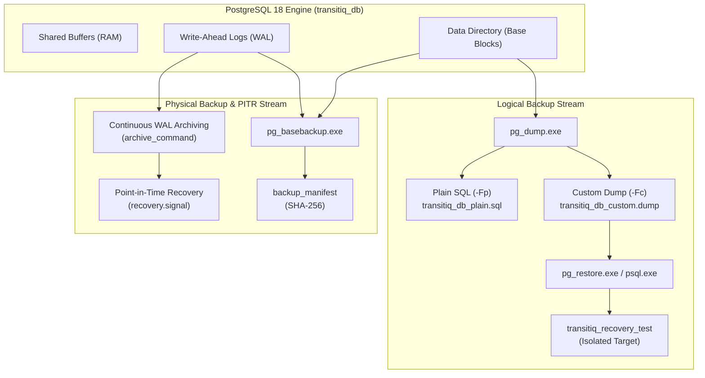

# TransitIQ: Database Backup, Recovery and Disaster Recovery Architecture

## 1. Executive Summary & Strategy Overview

In an intelligent municipal transportation system operating 24/7/365, database loss or downtime directly impairs real-time passenger tracking, driver scheduling, and fare collection.

The TransitIQ backup and recovery architecture combines two complementary disaster recovery strategies:
1. **Logical Backups (`pg_dump` / `pg_restore`)**: Flexible, version-portable, and capable of granular object-level or table-level restoration.
2. **Physical Cluster Backups & Point-in-Time Recovery (PITR) (`pg_basebackup` + Continuous WAL Archiving)**: High-performance, binary-level cluster snapshots with second-by-second crash and transaction replay.



---

## 2. Logical Backup Architecture (`pg_dump`)

`pg_dump` takes a consistent read-only snapshot of the database without blocking concurrent `SELECT`, `INSERT`, `UPDATE`, or `DELETE` transactions.

### 2.1 Backup Format Comparison

| Format | Flag | Extension | Parallel Restore (`-j`) | Selective Table Restore (`-t`) | Compression | Primary Use Case |
| :--- | :---: | :---: | :---: | :---: | :---: | :--- |
| **Custom** | `-Fc` | `.dump` | **Yes** | **Yes** | Built-in (ZLIB/LZ4) | **Standard Production Backup** |
| **Directory**| `-Fd` | Directory | **Yes** | **Yes** | Multi-file compression | Terabyte-scale databases |
| **Plain SQL**| `-Fp` | `.sql` | No | No | External | Human inspection & schema diffs |
| **Tar** | `-Ft` | `.tar` | No | No | No | Legacy tape ingestion |

### 2.2 Production Dump Command Reference
```powershell
# Custom Format (Recommended for TransitIQ production)
pg_dump -h localhost -p 5432 -U postgres -d transitiq_db -F c -b -v --no-owner -f "backups\transitiq_db_custom.dump"

# Schema-Only (Captures 17 tables, 5 views, routines, triggers without data)
pg_dump -h localhost -p 5432 -U postgres -d transitiq_db -s --clean --if-exists --no-owner -f "backups\transitiq_db_schema.sql"

# Data-Only (Captures live tuples for data synchronization)
pg_dump -h localhost -p 5432 -U postgres -d transitiq_db -a --disable-triggers -f "backups\transitiq_db_data.sql"
```

---

## 3. Logical Restoration Protocols (`pg_restore`)

> [!CAUTION]
> **Production Overwrite Protection**: Never run `pg_restore` or `psql` targeting `transitiq_db` directly during validation! Restorations must target an isolated recovery database such as `transitiq_recovery_test`.

### 3.1 Full Database Restoration
```powershell
# 1. Create target recovery database
createdb -h localhost -p 5432 -U postgres transitiq_recovery_test

# 2. Restore custom format archive
pg_restore -h localhost -p 5432 -U postgres -d transitiq_recovery_test -v --no-owner "backups\transitiq_db_custom.dump"
```

### 3.2 Selective Table Recovery (Scenario: Restoring an Inadvertently Dropped Table)
If an operator accidentally corrupts or drops `passenger_counts`, the table can be extracted from the custom dump without touching other operational tables:
```powershell
pg_restore -h localhost -p 5432 -U postgres -d transitiq_recovery_test -t passenger_counts "backups\transitiq_db_custom.dump"
```

### 3.3 Inspecting Table of Contents (TOC)
Before restoring, inspect all archive objects, sizes, and dependencies:
```powershell
pg_restore -l "backups\transitiq_db_custom.dump" > "backups\archive_toc.txt"
```

---

## 4. Physical Cluster Backup Architecture (`pg_basebackup`)

`pg_basebackup` captures binary copies of all tablespaces, system catalogs, and transaction logs.

### 4.1 Features in PostgreSQL 18
1. **WAL Ingestion (`-X stream`)**: Streams the Write-Ahead Log in parallel during basebackup execution, guaranteeing a self-contained, crash-consistent cluster state.
2. **Cryptographic Manifest (`--manifest-checksum=SHA256`)**: Generates `backup_manifest` recording every physical data file and its cryptographic hash.
3. **Verification Tool (`pg_verifybackup`)**: Re-computes SHA-256 hashes of all files against the manifest to guarantee that storage media did not suffer bit rot or silent truncation:
   ```powershell
   pg_verifybackup -v "backups\physical_basebackup_20261122"
   ```

---

## 5. Point-in-Time Recovery (PITR) Deep Dive

Point-in-Time Recovery allows restoring the database cluster to any precise millisecond in history (e.g. `2026-11-22 14:32:05.123+05:30`) immediately preceding a human error or hardware fault.

### 5.1 Continuous WAL Archiving Configuration (`postgresql.conf`)
```ini
wal_level = replica                  # Enables sufficient logging for WAL archiving
archive_mode = on                    # Turns on WAL archive process
archive_command = 'copy "%p" "C:\\PostgreSQL_Archives\\wal_archive\\%f"'
archive_timeout = 900                # Forces WAL segment switch every 15 minutes
```

### 5.2 Five-Step PITR Recovery Procedure
1. **Stop PostgreSQL Service**:
   ```powershell
   Stop-Service postgresql-x64-18
   ```
2. **Move Damaged Data Directory**:
   Rename active `data` directory to `data_failed_backup`.
3. **Restore Physical Base Backup**:
   Copy physical basebackup files into the clean `data` directory.
4. **Configure Recovery Target**:
   - Create empty trigger file: `data\recovery.signal`
   - In `data\postgresql.conf` (or `postgresql.auto.conf`), configure:
     ```ini
     restore_command = 'copy "C:\\PostgreSQL_Archives\\wal_archive\\%f" "%p"'
     recovery_target_time = '2026-11-22 14:30:00'
     recovery_target_action = 'promote'
     recovery_target_timeline = 'latest'
     ```
5. **Start PostgreSQL Service**:
   ```powershell
   Start-Service postgresql-x64-18
   ```
   PostgreSQL starts in recovery mode, replays WAL records up to the exact target second, removes `recovery.signal`, promotes to a new timeline, and accepts connections.

---

## 6. Windows Security & Automation Standards

1. **Credential Safety**: Never hardcode database passwords in PowerShell scripts or Git commits. Passwords should be supplied via `$env:PGPASSWORD` or `%APPDATA%\postgresql\pgpass.conf`.
2. **File Permissions**: The backup directory (`backups/`) must be restricted to the `Administrators` group and the PostgreSQL service virtual service account (`NT SERVICE\postgresql-x64-18`).
3. **Git Hygiene**: All `.dump`, `.sql`, and `.tar` backup files are strictly excluded from version control via `.gitignore`.
