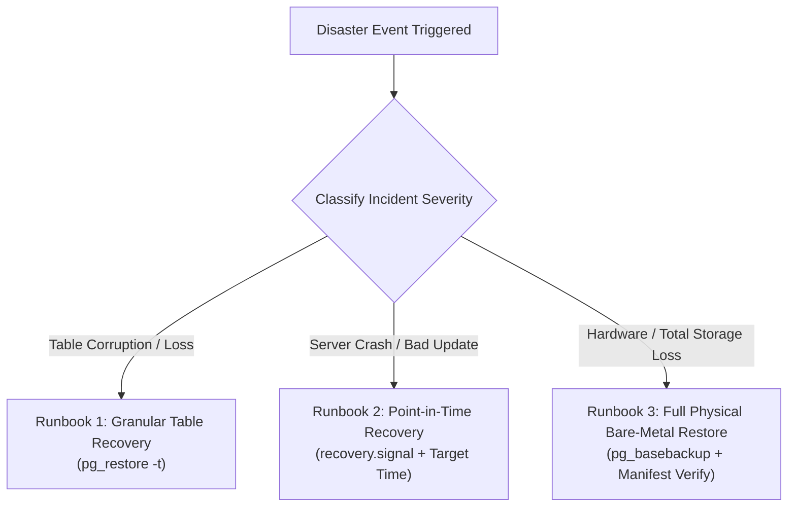

# TransitIQ: Disaster Recovery (DR) Plan & Business Continuity Strategy

**Document Version**: 1.0  
**Target Environment**: PostgreSQL 18 on Windows / Cloud Server  
**Primary Database**: `transitiq_db`  
**Target Recovery Database**: `transitiq_recovery_test`  

---

## 1. Disaster Recovery Objectives

Disaster recovery readiness is governed by two mission-critical service level agreements:

### 1.1 Recovery Point Objective (RPO)
*Maximum acceptable data loss measured in time.*
- **Logical Backup Stream**: $\le 24 \text{ hours}$ (Daily logical dumps).
- **Physical + Continuous WAL Archiving**: $\le 15 \text{ minutes}$ (Forces WAL segment switch every 900 seconds).
- **High-Availability Standby Mode**: $\approx 0 \text{ seconds}$ (Synchronous replication).

### 1.2 Recovery Time Objective (RTO)
*Maximum acceptable downtime to restore full database availability.*
- **Table Corruption / Accidental Deletion**: $\le 10 \text{ minutes}$ (Selective `pg_restore -t`).
- **Full Logical Restoration**: $\le 25 \text{ minutes}$ (`pg_restore -d transitiq_db`).
- **Physical Crash Recovery / PITR**: $\le 15 \text{ minutes}$ (`pg_basebackup` copy + WAL replay).

---

## 2. Backup Schedules and Retention Architecture

### 2.1 Cadence Schedule
| Backup Type | Tool | Execution Schedule | Window | Compression | Target Storage |
| :--- | :--- | :--- | :--- | :---: | :--- |
| **Physical Base Backup** | `pg_basebackup` | Weekly (Sunday) | 01:00 AM | Plain / TAR | Dedicated Backup Disk |
| **Logical Custom Dump** | `pg_dump -Fc` | Daily (Mon–Sat) | 02:00 AM | ZLIB Level 6 | Local NVMe + Offsite |
| **Schema DDL Archive** | `pg_dump -s` | Daily | 02:30 AM | None (Git) | Version Control / S3 |
| **Continuous WAL Logs** | `archive_command` | Continuous | Every 15 min | Native WAL | Secure Archive Vault |

### 2.2 Retention Policy (GFS - Grandfather-Father-Son)
- **Daily Backups**: Retained for **7 days**.
- **Weekly Backups**: Retained for **4 weeks**.
- **Monthly Backups**: Retained for **12 months**.
- **Annual Backups**: Retained for **7 years** for statutory transit audit compliance.

### 2.3 The 3-2-1 Backup Storage Standard
- **3 Copies of Data**: 1 Primary Production Database + 1 Local High-Speed Backup Volume + 1 Offsite Cloud Vault.
- **2 Different Storage Media**: Fast local NVMe arrays + immutable object storage (e.g. AWS S3 Glacier / Google Cloud Storage Vault).
- **1 Offsite Copy**: Geographically distinct region with Write-Once-Read-Many (WORM) object lock to defend against ransomware.

---

## 3. Disaster Scenarios & Step-by-Step Runbooks



### 3.1 Runbook 1: Granular Table Recovery (Accidental Table Drop / Truncate)
*Symptom: A junior operator or failing batch script truncated `passenger_counts` or dropped `routes`.*

1. **Step 1: Isolate the Incident**: Do NOT drop the entire database.
2. **Step 2: Create a Temporary Recovery Database**:
   ```powershell
   createdb -h localhost -p 5432 -U postgres temp_table_recovery
   ```
3. **Step 3: Extract the Specific Table from Custom Dump**:
   ```powershell
   pg_restore -h localhost -p 5432 -U postgres -d temp_table_recovery -t passenger_counts "backups\transitiq_db_custom_latest.dump"
   ```
4. **Step 4: Stream Table Data back to Production**:
   ```powershell
   pg_dump -h localhost -p 5432 -U postgres -d temp_table_recovery -t passenger_counts -a | psql -h localhost -p 5432 -U postgres -d transitiq_db
   ```
5. **Step 5: Teardown Temporary Database**:
   ```powershell
   dropdb -h localhost -p 5432 -U postgres temp_table_recovery
   ```
6. **Estimated Downtime**: **< 5 minutes**.

---

### 3.2 Runbook 2: Point-in-Time Recovery (Malicious Data Injection or Human Error)
*Symptom: An erroneous bulk update corrupted trip statuses at 2026-11-22 14:15:00.*

1. **Step 1: Stop Application Traffic**: Terminate client connections and stop background loaders.
2. **Step 2: Stop PostgreSQL Service**:
   ```powershell
   Stop-Service postgresql-x64-18
   ```
3. **Step 3: Quarantine Corrupted Cluster**:
   ```powershell
   Rename-Item -Path "C:\Program Files\PostgreSQL\18\data" -NewName "data_corrupted_quarantine"
   ```
4. **Step 4: Restore Most Recent Physical Base Backup**:
   Copy baseline snapshot into `C:\Program Files\PostgreSQL\18\data`.
5. **Step 5: Create Recovery Signal and Configuration**:
   Create `data\recovery.signal`. In `data\postgresql.auto.conf`, append:
   ```ini
   restore_command = 'copy "C:\\PostgreSQL_Archives\\wal_archive\\%f" "%p"'
   recovery_target_time = '2026-11-22 14:14:55'
   recovery_target_action = 'promote'
   recovery_target_timeline = 'latest'
   ```
6. **Step 6: Start PostgreSQL Service**:
   ```powershell
   Start-Service postgresql-x64-18
   ```
   PostgreSQL reads all WAL segments up to 5 seconds before the corruption, promotes, and restores full data fidelity.

---

### 3.3 Runbook 3: Total Hardware Failure (Bare-Metal Disaster Recovery)
*Symptom: Primary server motherboard or storage array failure.*

1. Provision new host with PostgreSQL 18 installed.
2. Pull latest physical base backup and WAL archives from offsite cloud vault.
3. Verify backup manifest with `pg_verifybackup -v <backup_dir>`.
4. Restore base cluster and start PostgreSQL engine.
5. Execute [validate_backup.ps1](file:///d:/Intelligent-Public-Transportation-Management-and-Analytics-System/scripts/validate_backup.ps1) and [32_restore_validation.sql](file:///d:/Intelligent-Public-Transportation-Management-and-Analytics-System/database/32_restore_validation.sql).
6. Update DNS / Load Balancer IP to direct transit traffic to the restored host.

---

## 4. Disaster Recovery Roles & Responsibility Matrix

| Role | Primary Responsibility | Secondary / Escalation |
| :--- | :--- | :--- |
| **Lead DBA** | Orchestrates restore procedure, validates data integrity, executes PITR. | System Architect |
| **System Admin** | Provisions recovery infrastructure, mounts SAN/storage, manages firewall ports. | Cloud Operations |
| **Incident Commander**| Declares DR state, communicates with transit authorities, issues recovery sign-off. | CTO / Executive |
| **QA / Analytics Lead**| Validates analytical views, reports, and real-time dashboard connectivity. | BI Engineer |

---

## 5. Post-Recovery Verification Checklist

- [ ] All 17 core operational tables verified present with expected row counts.
- [ ] All 5 analytical views queried with zero SQL errors.
- [ ] All 3 stored procedures and 9 functions verified in `pg_proc`.
- [ ] All 8 triggers active and verified against test DML.
- [ ] Foreign key relationships checked for 0 orphaned records.
- [ ] Application service accounts (`test_dispatcher`, etc.) connect successfully.
- [ ] Incident timeline and root cause documented.
