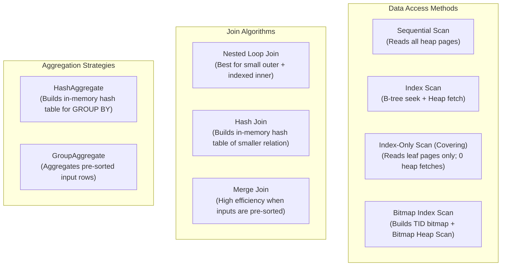

# TransitIQ: Database Performance Optimization and Query Tuning Architecture

## 1. Executive Summary

In enterprise transit management systems, database performance directly impacts operational punctuality, real-time vehicle dispatching, passenger ticketing latency, and analytical reporting throughput.

This document details the PostgreSQL 18 performance engineering principles, cost model mechanics, indexing strategies, query rewriting patterns, routine maintenance protocols, and production monitoring frameworks implemented across **TransitIQ**.

---

## 2. PostgreSQL Cost Model & Execution Engine Mechanics

PostgreSQL employs a sophisticated **Cost-Based Optimizer (CBO)** to determine the most efficient execution plan among millions of mathematical permutations.

### 2.1 The Planner Cost Metrics
Every execution node in an `EXPLAIN` plan displays `(cost=startup_cost..total_cost rows=estimated_rows width=row_bytes)`.
- **`startup_cost`**: Disk and CPU units spent before the node can return its first tuple (e.g., sorting entire table before outputting row 1).
- **`total_cost`**: Total estimated work to process all tuples through the node.
- **Cost Weights**:
  - `seq_page_cost = 1.0` (Sequential disk block fetch)
  - `random_page_cost = 4.0` (Random seek on spinning disk, or `1.1` - `1.5` on modern NVMe SSDs)
  - `cpu_tuple_cost = 0.01` (CPU effort to process one tuple)
  - `cpu_operator_cost = 0.0025` (CPU effort to evaluate one `WHERE` operator or expression)

> [!IMPORTANT]
> **Estimated Cost vs Actual Time**: Planner cost is a dimensionless theoretical unit, while `actual time=startup..total (ms)` in `EXPLAIN ANALYZE` records wall-clock milliseconds measured via the hardware clock. Never confuse cost with real execution duration.

---

## 3. Scan & Join Strategy Comparison



### 3.1 Scan Methods
1. **Sequential Scan**: Reads every page in the table sequentially. Optimal when reading a large percentage (> 15-20%) of the relation or when the table fits on 1-2 memory pages.
2. **Index Scan**: Traverses the B-tree to find matching tuple pointers (TIDs) and retrieves individual rows from the heap table.
3. **Index-Only Scan**: When all columns requested in the query are present in the index itself (via indexed keys or `INCLUDE` payload columns) and the visibility map confirms all tuples on the page are visible, PostgreSQL bypasses table heap blocks completely.
4. **Bitmap Index Scan**: Collects matching TIDs into an in-memory bitmap and fetches heap blocks in sequential physical disk order, preventing random disk thrashing.

### 3.2 Join Algorithms
1. **Nested Loop Join**: For each row in the outer relation, seeks the inner relation. Optimal when the outer set is small and the inner table has an indexed foreign key.
2. **Hash Join**: Evaluates inner relation rows into a memory hash table, then scans the outer table once. Ideal for large, unsorted multi-table joins.
3. **Merge Join**: Merges two streams already sorted by the join key. Extremely fast when joining over indexed primary or foreign keys.

---

## 4. Index Optimization Architecture

Adding indexes indiscriminately degrades `INSERT`, `UPDATE`, and `DELETE` throughput because every write must update all associated B-trees. TransitIQ employs targeted indexing patterns:

### 4.1 Composite Indexing
When queries frequently filter by multiple columns (e.g. `trip_status` and `service_date`):
```sql
CREATE INDEX idx_trips_status_service_date ON trips(trip_status, service_date);
```
- **Column Ordering Rule**: Equality columns (`trip_status = 'RUNNING'`) precede range columns (`service_date >= CURRENT_DATE`) to enable maximum B-tree branch pruning.

### 4.2 Partial Indexing
In transit operations, 80-90% of operational queries inspect `COMPLETED` trips or `ACTIVE` buses:
```sql
CREATE INDEX idx_trips_completed_bus ON trips(bus_id, service_date)
WHERE trip_status = 'COMPLETED';

CREATE INDEX idx_buses_active ON buses(bus_id, bus_type_id)
WHERE status = 'ACTIVE';
```
- **Benefits**:
  - Excludes `CANCELLED` and `SCHEDULED` rows from the index structure.
  - Reduces index disk size by 30-50%.
  - Increases buffer cache residency, ensuring index pages remain hot in memory.

### 4.3 Covering Indexes with `INCLUDE`
```sql
CREATE INDEX idx_passenger_covering ON passenger_counts(trip_stop_log_id)
INCLUDE (boarding_count, alighting_count);
```
- Attaches payload columns (`boarding_count`, `alighting_count`) to the index leaf pages without expanding the search key B-tree nodes.
- Unlocks **Index-Only Scans** with 0 heap block fetches.

---

## 5. Query Rewriting Catalog (5 Core Transformations)

### 5.1 Rewrite 1: Correlated Scalar Subquery to Derived Table JOIN
- **Problem**: Subqueries inside `SELECT` run once per parent row ($O(N)$ execution overhead).
- **Optimization**: Pre-aggregate the child table once using `GROUP BY`, then attach via a single `LEFT JOIN`.

### 5.2 Rewrite 2: Filtered Aggregation (`FILTER`) vs Multi-Pass `CASE`
- **Problem**: `COUNT(CASE WHEN ... THEN 1 END)` forces full expression evaluation in the execution loop.
- **Optimization**: Use standard SQL:2003 `COUNT(*) FILTER (WHERE condition)`, which the PostgreSQL engine evaluates directly in the accumulator step.

### 5.3 Rewrite 3: Semi-Join Optimization (`EXISTS` vs `IN`)
- **Problem**: `WHERE id IN (SELECT id ...)` can trigger hash table subplans or require `NULL` safety checks.
- **Optimization**: `WHERE EXISTS (SELECT 1 ...)` short-circuits execution as soon as the first matching child tuple is located.

### 5.4 Rewrite 4: Predicate Pushdown before Multi-Table Expansion
- **Problem**: Joining all 6 tables across historical time before applying a date filter forces intermediate hash tables to hold millions of irrelevant rows.
- **Optimization**: Filter parent partitions early in a CTE, restricting join cardinality in the initial scan steps.

### 5.5 Rewrite 5: Single-Pass Window Ranking vs Quadratic Cross-Joins
- **Problem**: Self-joining drivers to count how many peers have more completed trips produces $O(N^2)$ comparisons.
- **Optimization**: Native `DENSE_RANK() OVER (ORDER BY completed_trips DESC)` computes exact rankings in a single sort-free window pass.

---

## 6. Routine Database Maintenance & Vacuum Architecture

PostgreSQL's MVCC creates new tuple versions upon `UPDATE` and marks old versions as dead upon `DELETE`.

### 6.1 Routine Tasks
- **`ANALYZE table_name`**: Samples table rows and populates `pg_statistic`, ensuring the CBO has accurate distribution histograms and distinct count estimates.
- **`VACUUM table_name`**: Reclaims space occupied by dead tuples, updates the visibility map (enabling Index-Only Scans), and freezes transaction IDs to prevent transaction wraparound.
- **`VACUUM ANALYZE`**: Performs both space reclamation and statistics refresh in a single pass.

> [!CAUTION]
> **VACUUM FULL Warning**: `VACUUM FULL` rewrites the entire physical table file to disk. It requires an exclusive `ACCESS EXCLUSIVE` lock, completely blocking all concurrent `SELECT`, `INSERT`, `UPDATE`, and `DELETE` queries. Never run `VACUUM FULL` in production without scheduled maintenance downtime!

### 6.2 Recommended Autovacuum Tuning for High-Volume Transit Systems
```ini
# postgresql.conf recommendations for high-throughput OLTP:
autovacuum = on
autovacuum_naptime = 15s                 # Default 1min; checks for dirty tables every 15 seconds
autovacuum_vacuum_scale_factor = 0.05    # Vacuums when 5% of rows are dead (default 0.20)
autovacuum_analyze_scale_factor = 0.02   # Analyzes when 2% of rows change (default 0.10)
maintenance_work_mem = 256MB             # Allocates sufficient memory for fast vacuum worker sweeps
```

---

## 7. Performance Monitoring Queries Playbook

DBAs can run [29_database_monitoring.sql](file:///d:/Intelligent-Public-Transportation-Management-and-Analytics-System/database/29_database_monitoring.sql) to inspect:
1. **Blocked Sessions**: Uses `pg_blocking_pids()` to isolate lock contention trees.
2. **Buffer Hit Ratio**: Monitors `pg_statio_user_tables` to verify memory caching.
3. **Dead Tuple Ratio**: Alerts when dead rows exceed 10-20% of relation volume.
4. **Index Scans vs Seq Scans**: Detects queries falling back to unindexed sequential scans.
5. **Abandoned Transactions**: Identifies `idle in transaction` sessions older than 30 seconds.
